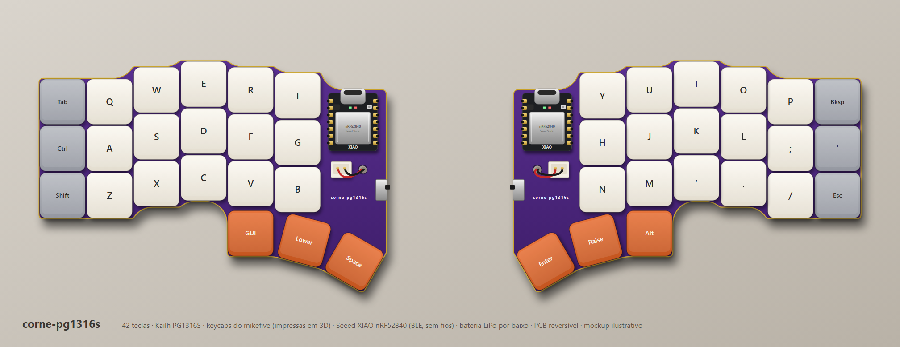
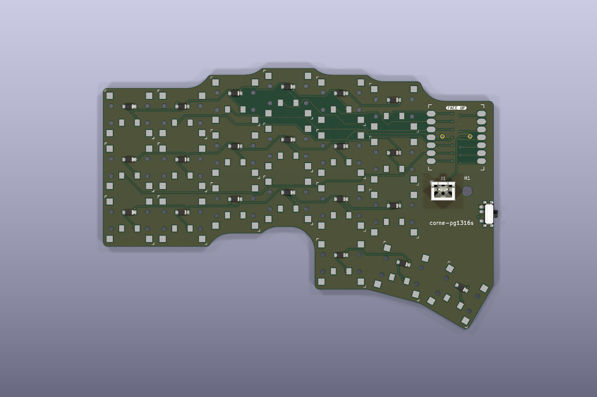
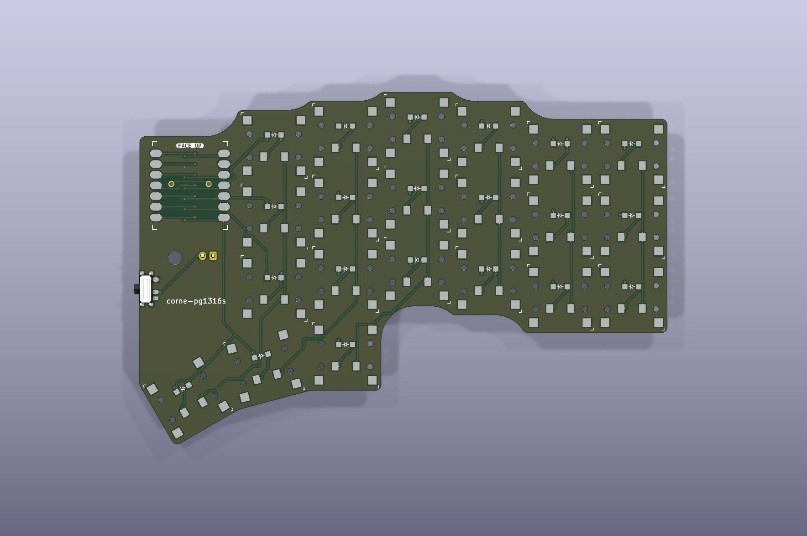

# corne-pg1316s

PCB reversível e sem fios no formato **Corne** (3×6 + 3 polegares por metade, 42 teclas)
para os switches ultrafinos **Kailh PG1316S**, com keycaps impressas em 3D (do
[mikefive](https://github.com/mikeholscher/zmk-config-mikefive)). É a versão "irmã" do
[corne-x](https://github.com/deSales327/corne-x), que usa switches Kailh X (PG1425).



| Frente | Verso |
| :---: | :---: |
|  |  |

## Estado
- Roteada nas duas camadas, com plano de GND.
- **DRC do KiCad 10: 0 violações e 0 ligações em falta.**
- Gerbers e furação prontos em [`corne-pg1316s-gerbers.zip`](corne-pg1316s-gerbers.zip).
- **Ainda não foi fabricada nem testada.** O footprint do switch foi desenhado a partir da ficha técnica da Kailh, mas ainda não foi experimentado com um switch físico.

## Componentes (por metade)
| Qtd. | Peça |
|---|---|
| 21 | Kailh PG1316S (SMD) |
| 21 | Díodo 1N4148W, SOD-123 |
| 1 | Seeed XIAO nRF52840 (BLE) |
| 1 | Interruptor SPDT (o mesmo do dust) |
| 1 | Conector JST-XH 2,50 mm, vertical, 2 pinos |
| 1 | Bateria LiPo pequena com ficha JST-XH |
| 21 | Keycaps impressas, ver [`keycaps/`](keycaps/) |

## Diferenças para o corne-x
- **Espaçamento de 17 × 17 mm** para keycaps de 16,5 × 16,5 mm. Cada metade mede 125,6 × 83,9 mm.
- **Footprint PG1316S reversível**, desenhado em `gerar_pcb.py` a partir da ficha técnica `CPG1316S01D02`:
  - Os contactos e os pads do chassi têm um furo metalizado que liga a frente ao verso, por isso o switch pode ser soldado em qualquer face.
  - Há furos para os pinos de alinhamento das duas faces.
- **Díodos na cavidade debaixo do switch**, na mesma face que ele, como no mikefive. Os pads SMD existem nas duas faces.
- **Soldadura:** os switches são SMD. Numa metade ficam na frente e na outra no verso. Uma placa de aquecimento (hotplate) com pasta de solda é o mais prático; com ferro de soldar dá, mas custa mais.

## Bateria
- **J1**: JST-XH 2,50 mm vertical, de furos passantes. O pino 1 é o BAT+ e o pino 2 o BAT−.
- **H1**: furo de 3,2 mm para passar os fios da bateria, que fica por baixo da placa.
- **PWR1**: interruptor no BAT−.
- Atenção à altura: o JST-XH vertical tem cerca de 7 mm, muito mais do que o resto do teclado.

## Matriz e pinos do XIAO
| Pino | Função | Pino | Função |
|---|---|---|---|
| D0 | c5 (indicador interno) | D7 | r0 (polegares) |
| D1 | c4 (indicador) | D8 | r1 (fila de baixo) |
| D2 | c3 (médio) | D9 | r2 (fila home) |
| D3 | c2 (anelar) | D10 | r3 (fila de cima) |
| D4 | c1 (mindinho) | D6 | livre |
| D5 | c0 (mindinho externo) | | |

- O cátodo dos díodos (pad 1) fica na linha, por isso o sentido é COL2ROW (no ZMK, `diode-direction = "col2row"`).
- Os polegares usam as colunas c3, c4 e c5 da linha r0.

## Regenerar
```
python gerar_pcb.py caminho/para/dust/pcbs/dust.kicad_pcb
"%LOCALAPPDATA%\Programs\KiCad\10.0\bin\python.exe" finalizar_pcb.py caminho/para/freerouting-2.5.0.jar
python mockup.py
```
Precisas do `shapely` (pip), do KiCad 10, do Freerouting 2.5 e do Java 25.

## Créditos
- Díodo, XIAO e interruptor: [dust](https://github.com/hazels-garage/dust), de Jason Hazel (CC BY 4.0).
- Keycaps e referência do PG1316S: [mikefive](https://github.com/mikeholscher/zmk-config-mikefive), de Mike Holscher. Uso permitido com crédito ao autor.
- Footprint do switch: desenhado a partir da ficha técnica da Kailh (CPG1316S01D02).
- Layout: Corne (crkbd), de foostan (MIT).
- Este projeto: CC BY 4.0, exceto as keycaps, que seguem as condições do autor.
