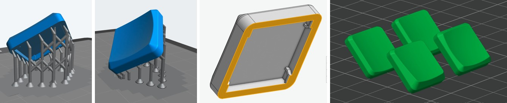

# Keycaps PG1316S (para imprimir)

Estas keycaps são de **Mike Holscher**, do projeto
[mikefive](https://github.com/mikeholscher/zmk-config-mikefive/tree/main/files/custom-keycaps).
O autor permite usá-las, modificá-las e partilhá-las, desde que se mantenha o crédito.

| Ficheiro | Para quê | Quantas (corne-pg1316s) |
|---|---|---|
| `stl/…_normal.stl` | teclas normais, estilo MBK | 36 |
| `stl/…_normalthumb.stl` | polegares (aresta de baixo mais suave) | 6 |
| `stl/…_keywellcenter.stl` / `…_keywellangled.stl` | variante "keywell" (alternativa) | — |

Os ficheiros `step/` são os originais. Os STL foram convertidos a partir deles e medem 16,5 × 16,5 mm.

## Dicas de impressão (do autor)
- As tolerâncias são **muito apertadas**. Imprime 2 ou 3 primeiro e ajusta a escala até ficarem firmes sem prender o switch. Há quem tenha tido bons resultados a **101 %**.
- **Resina:** o autor imprimiu-as numa Anycubic Photon S, com suportes só na aresta exterior.
- **FDM:** resultou "surpreendentemente bem" numa Bambu X1C com **camadas de 0,08 mm**, na orientação da imagem abaixo.
- **Não as mandes imprimir num serviço de resina comercial.** O encaixe varia muito de peça para peça. Se não tiveres impressora, MJF é a melhor opção, com todas as peças na mesma orientação.

